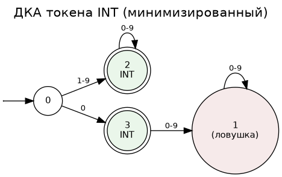
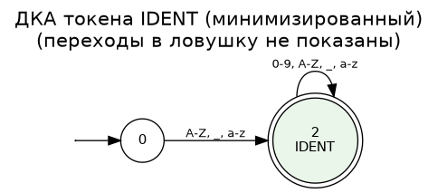
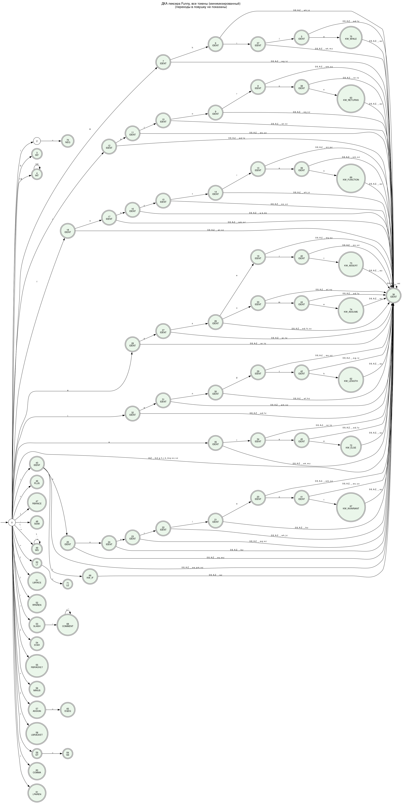

# Отчёт — HW1. Лексер

## 1. Список регулярных выражений токенов

| #  | Токен        | Регулярное выражение     | skip   |
|----|--------------|--------------------------|--------|
| 0  | KW_FUNCTION  | `function`               | нет    |
| 1  | KW_RETURNS   | `returns`                | нет    |
| 2  | KW_WHILE     | `while`                  | нет    |
| 3  | KW_IF        | `if`                     | нет    |
| 4  | KW_ELSE      | `else`                   | нет    |
| 5  | KW_ASSERT    | `assert`                 | нет    |
| 6  | KW_ASSUME    | `assume`                 | нет    |
| 7  | KW_INVARIANT | `invariant`              | нет    |
| 8  | KW_LENGTH    | `length`                 | нет    |
| 9  | IDENT        | `[A-Za-z_][A-Za-z_0-9]*` | нет    |
| 10 | INT          | `0\|[1-9][0-9]*`         | нет    |
| 11 | WS           | `[ \t\r\n]+`             | **да** |
| 12 | COMMENT      | `//[^\n]*`               | **да** |
| 13 | LPAREN       | `\(`                     | нет    |
| 14 | RPAREN       | `\)`                     | нет    |
| 15 | LBRACKET     | `\[`                     | нет    |
| 16 | RBRACKET     | `\]`                     | нет    |
| 17 | LBRACE       | `{`                      | нет    |
| 18 | RBRACE       | `}`                      | нет    |
| 19 | COMMA        | `,`                      | нет    |
| 20 | SEMI         | `;`                      | нет    |
| 21 | EQEQ         | `==`                     | нет    |
| 22 | NEQ          | `!=`                     | нет    |
| 23 | LE           | `<=`                     | нет    |
| 24 | GE           | `>=`                     | нет    |
| 25 | LT           | `<`                      | нет    |
| 26 | GT           | `>`                      | нет    |
| 27 | ASSIGN       | `=`                      | нет    |
| 28 | PLUS         | `\+`                     | нет    |
| 29 | MINUS        | `-`                      | нет    |
| 30 | STAR         | `\*`                     | нет    |
| 31 | SLASH        | `/`                      | нет    |

Индекс в таблице = приоритет при разрешении конфликтов равной длины
совпадения (меньше индекс — выше приоритет). Ключевые слова стоят раньше
`IDENT`, поэтому `if`, `while` и т.д. не распознаются как идентификаторы;
при этом `iffy`, `elsewhere` и подобные всё равно целиком становятся
`IDENT`, так как правило maximal munch выбирает более длинное совпадение
независимо от приоритета — приоритет решает только споры при **равной**
длине.

## 2. Размер автомата до/после минимизации

Полученные конвейером `regex → NFA (Thompson) → DFA (subset construction) →
min-DFA (Hopcroft)` значения (воспроизводятся командой `python3 build.py`):

| Показатель                                 | Значение         |
|--------------------------------------------|------------------|
| Токенов определено                         | 32               |
| Размер алфавита ДКА                        | 98 символов      |
| Состояний ДКА до минимизации               | 80               |
| Состояний ДКА после минимизации (Хопкрофт) | 76               |
| Сокращение                                 | 4 состояния (5%) |

Небольшое сокращение объясняется тем, что объединённый НКА для 32 разных
токенов и так строится довольно "экономно" (каждый токен — своя ветка от
общего старта), и subset construction уже не создаёт значительной
избыточности; тем не менее несколько эквивалентных по поведению состояний (в основном — хвостовые состояния коротких
литеральных операторов,
ведущие себя идентично ловушке дальше) были склеены.

## 3. Визуализация ДКА

Картинки построены через `draw_dfa.py` (graphviz), рёбра с одинаковым
источником/приёмником объединены в одну подписанную стрелку.

**ДКА токена INT (минимизированный, с явной ловушкой)** — хорошо видно,
почему `00`/`01` не матчатся целиком: из состояния "после одного нуля"
нет исходящих переходов по цифрам, только в ловушку.

**ДКА токена IDENT** (минимизированный, ловушка скрыта):

**Весь ДКА лексера (минимизированный, 32 токена, ловушка скрыта)** — видно
дерево из общих префиксов ключевых слов, сходящееся в `IDENT`, когда
слово продолжается дальше префикса:

## 4. Ловушка (trap / dead state)

ДКА достраивается до **полностью определённой** функции переходов: для
каждого состояния и каждого символа алфавита явно определён переход. Все
переходы, которых не было в исходном (частичном) ДКА после subset
construction, ведут в отдельное непринимающее состояние-ловушку с
петлёй по всем символам алфавита (`trap → trap` для любого символа).

Alphabet ДКА ограничен множеством символов, реально встречающихся хотя бы
в одном регулярном выражении токенов (98 символов из печатного ASCII).
Любой символ **вне** этого множества — в том числе весь диапазон
non-ASCII (кириллица, эмодзи и т.д.) — лексер (`lexer.py::CombinedLexer.scan`)
трактует как переход в ловушку без обращения к таблице, что и реализует
требование «выход за алфавит должен попадать в ловушку». Символ, из-за
которого сканирование не смогло построить ни одного принимающего
совпадения, репортится как лексическая ошибка с указанием позиции;
лексер восстанавливается, пропуская один символ, и продолжает разбор.

После минимизации ловушка гарантированно остаётся ровно одним состоянием (проверено тестом
`test_trap_state_is_a_sink_and_non_accepting`), так как
её "сигнатура" (непринимающее состояние, самопереход по всем символам)
уникальна и не совпадает ни с каким промежуточным состоянием разбора
токенов.

## 5. Тесты

82 теста в `tests/test_lexer.py`, все проходят (`python3 -m pytest tests/ -v`).
Обязательные сценарии из задания покрыты полностью: пустая строка;
строки только из пробелов/табов/CRLF; `0`, `00`, `01` (в т.ч. как
негативные примеры для регулярного выражения INT — ведущий ноль не
принимается) и другие числа; идентификаторы с `_`; все 9 ключевых слов (отдельно проверено, что их
приставки/расширения — `iffy`, `elsewhere`,
`whilex`, `lengths`, `assertion` — остаются `IDENT`, а не обрезаются до
ключевого слова); все операторы/разделители `()[]{},;` и
`+ - * / == != <= >= < > =` (в т.ч. приоритет двухсимвольных операторов
над односимвольными); однострочные комментарии `//...` до конца строки (не поглощающие сам `\n`); выход за алфавит
(non-ASCII → ловушка →
ошибка с восстановлением); целая программа на языке Funny (вычисление
Фибоначчи, `examples/fib.fun`) — токенизируется без единой ошибки, все
ключевые слова и операторы распознаются корректно.

Дополнительно проверены структурные свойства самого автомата: полнота
функции переходов (каждое состояние определено для каждого символа
алфавита), корректность ловушки, и то, что минимизация не увеличивает
число состояний (`min ≤ raw`).

## 6. Формат сдачи / связь с проектом

`build.py --out table.json` выгружает таблицу переходов минимизированного
ДКА в плоском JSON (`alphabet`, `start`, `trap`, `states`, `accepting`,
`transitions`), пригодном для повторного использования в лексере проекта
на контрольной точке T0 без привязки к языку реализации. Модуль
`lexer.py` (в частности `build_lexer()` и `CombinedLexer.scan`) может
также использоваться напрямую как Python-библиотека.
